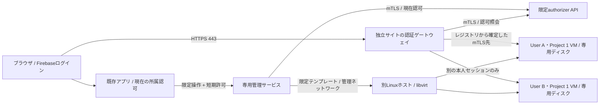

# 第8段階：専用Linux基盤と独立HTTPSの設計

## 現在の到達点

2026年11月17日、mainの5758a62（PR #9マージ済み）を確認して設計した。
依頼者の追加指示に従い、**別Linuxホスト上のUser×ProjectごとのLinux VM**を推奨構成に固定する。
VM、code-server、公開接続、DNS、証明書は作成していない。第7段階の実行ゲートも変更しない。

| 区分 | 状態 |
| --- | --- |
| 既存実装 | Firebase失効確認、現在所属・Project対応確認、常時無効の制御API、全拒否のWebSocket、限定DTO、診断資源の保全 |
| 今回追加 | 本構成図・容量試算・手動構築/復旧手順・合否表、設計JSONの静的検査とモックテスト |
| 設計のみ | VM管理サービス、DNS/TLS、認証ゲートウェイ、短期セッション、リース、保存先切替・移送 |
| 未準備・未検証 | 新Linuxホスト/KVM、実VM、HTTPS接続先、code-server実動作、脱出耐性、接続中失効、実障害復旧 |

既存の[第7段階](../isolated-user-editors.md)と[安全性レビュー](../editor-control-safety-review.md)を引き継ぐ。
ProjectStorageの0700、共有Git・レビュー/統合ジャーナルのbackend専有、実行503・WS全拒否を維持する。
既存editor_preflightはrootless/runsc案の事前確認用であり、VM案の合格判定へ転用しない。
そのツールやDocker Desktopの設定も今回変更しない。

## 候補比較と選定

これは小人数の初期運用を想定した設計上の比較で、性能ベンチマークや安全性認証ではない。

| 候補 | 利用者間の主な境界 | 導入難易度 | 必要リソースの傾向 | 運用負担・残るリスク |
| --- | --- | --- | --- | --- |
| 共有Linux VM内の通常コンテナ | namespace/cap/ホストカーネル | 低〜中 | 小 | 同じゲストカーネルを共有。任意悪意コードに対する今回の採用基準には不足 |
| 専用Linux上のrootless＋runsc | user namespace＋gVisorのアプリケーションカーネル | 中〜高 | VMより密度を上げやすい | rootlessのUID/容量/cgroupとrunsc互換性を別々に確認。Node/拡張/コンパイラの実測が必要 |
| User×Project別のmicroVM（Firecracker等） | 別ゲストカーネル＋KVM、縮小した仮想デバイス | 高 | 通常VMより小さくする余地 | kernel/rootfs、jailer、TAP、制御API、復旧の組立てが必要。初期チームの保守負担が大きい |
| **User×Project別Linux VM（KVM/libvirt）** | **専用ゲストカーネル・データディスク・仮想NIC** | **中〜高** | **大** | **VMごとのOS更新とバックアップが増える。ハイパーバイザー/管理者は信頼境界に残る** |

技術上の違いは[Docker rootless](https://docs.docker.com/engine/security/rootless/)、
[gVisorの境界](https://gvisor.dev/docs/architecture_guide/intro/)と[互換性](https://gvisor.dev/docs/user_guide/compatibility/)、
[Firecracker設計](https://github.com/firecracker-microvm/firecracker/blob/main/docs/design.md)・
[本番ホスト要件](https://github.com/firecracker-microvm/firecracker/blob/main/docs/prod-host-setup.md)、
[libvirtのQEMU/KVMドライバー](https://libvirt.org/drvqemu.html)を参照した。
rootlessはデーモンを含む非root化、runscはシステムコール実装の隔離であり、同じ仕組みではない。
microVMもKVMやホスト更新・実行プロセスの制限を不要にはしない。

選定理由は、少人数では密度よりも「一つの所有関係＝一つのカーネルとディスク」を
確認・保全しやすいことを優先するため。管理系の経験を得た後のmicroVM移行は別設計とする。
VMなら脱出・DoS・CPU側チャネル・管理者侵害がなくなる、という判断ではない。

## 構成と信頼境界

- **実行VM（ワーカー）**：一つのUser×Projectだけ。code-serverは非root、sudo不可。
  共有FS、virtiofs/9p、ホストデバイス、Docker/libvirtソケット、DB/Firebase鍵を渡さない。
  自分のVM内でroot相当へ侵入される場合も想定し、ネットワーク遮断はゲスト外で強制する。
- **Linuxホスト**：既存アプリ/Docker Desktopとは別の管理対象。KVMと更新済みQEMU/libvirt、
  sVirt/AppArmor等のVMプロセス制限を利用し、任意QEMU引数・デバイスパススルーを許可しない。
  [libvirtのパススルーと制限](https://libvirt.org/kbase/qemu-passthrough-security.html)も確認対象。
- **管理サービス**：別の管理環境で動作し、固定テンプレート・レジストリ・操作許可だけでVMを操作する。
  汎用XML、exec、任意イメージ/ホストパス、削除をアプリから受け付けない。
- **FastAPI**：ハイパーバイザー管理者の鍵、libvirt/Dockerソケット、SSH管理権限を持たない。
  第7段階のDTOに沿った限定要求だけを認証済み管理サービスへ渡す設計。今回は通信しない。
- **authorizer**：既存User/Team/Projectを照会する限定内部APIの論理役割。
  DB/Firebase管理資格情報は既存アプリ側だけ。gateway/manager/実行VMへ渡さない。

ホストrootやハイパーバイザー管理者は複数VMのディスク/メモリへ影響し得る。
「他ユーザーを読めない」の対象は実行VMと利用者プロセスであり、信頼済み管理者まで
暗号学的に排除する設計ではない。管理者を絞り、別ID・監査・更新・バックアップで扱う。

## 小人数向け容量試算

**以下は調達前の初期予算案で、測定済み最低要件や製品購入の推奨ではない。**
各実行VMは2 vCPU・4 GiB RAM、更新用root 16 GiB・個人データ20 GiBを初期案とする。
ホスト/管理/gateway/VMプロセス余裕に4 vCPU・8 GiB RAM・64 GiBディスクを確保し、
バックアップ予算を別枠256 GiBとする。CPU・RAM・保存容量の過剰割当ては初期案では行わない。

| 同時起動数N | CPU予算 4+2N | RAM予算 8+4N GiB | ディスク予算 64+256+36N GiB |
| ---: | ---: | ---: | ---: |
| 1 | 6 vCPU | 12 | 356 |
| 2 | 8 vCPU | 16 | 392 |
| 3 | 10 vCPU | 20 | 428 |
| 4 | 12 vCPU | 24 | 464 |

最初の計画値は**12 vCPU相当・32 GiB RAM・512 GiB SSD、同時起動上限4**。
最初は合成データの1〜2 VMだけを将来の検証対象とし、4 VMを既定で起動しない。
vCPUは予算単位であり、物理コア/スレッドやクラウドのCPU時間の保証と同一ではない。
コンパイル、拡張機能、言語サーバー、ディスクIOを同時に測定してから上限を決め直す。

この表は停止中の保存環境もN個までという初期試算。
実際の容量は**起動数ではなく保持環境総数P×36 GiB**にroot/データ分を置き換える。
JSONでもmax_runningとmax_retainedを分け、停止中を含む保持数でディスク予算を検査する。
初期例は両方4。起動1・保持6ではCPU/RAMが足りても、このディスク予算を超えるため拒否する。
停止中もディスクとバックアップを予約するので、ユーザー/Projectが増えたら起動枠が空いていても拒否する。
バックアップ256 GiBは無料領域ではなく、世代数・変更量・暗号化済み別媒体への複製を計測する予算。
表の256 GiBはホスト内の保全/復元確認用予算であり、これとは別に少なくとも同等の
別媒体/別障害領域の容量と鍵管理を計画する。その費用・帯域は本体512 GiBに含めない。
2世代の個人データだけなら4×20×2=160 GiBだが、root/差分/作業余裕も必要。
同一ホストのコピーだけを災害復旧用バックアップとは扱わない。

RAMスワップ依存、無制限thin provisioning、無制限の同時起動は許可しない。
容量不足は503等で停止し、古いVM/データを自動削除しない。
静的ツールは足算の整合性だけを確認し、性能十分性は判定しない。

## ネットワーク：ゲスト外の既定拒否

VMごとの仮想NIC/ポートとACLをホスト側に置き、IPv4/IPv6、L2横断、ホスト宛ても遮断する。
同じbridgeで外部へforwardしないだけではVM間通信を遮断できないため、ポート隔離と
明示ACLを含めて実測する。[libvirt network形式](https://libvirt.org/formatnetwork.html)を参照。

| 開始側 → 宛先 | 設計上の業務通信 | 制約 |
| --- | --- | --- |
| browser → gateway | HTTPS 443 | 公開するのはgatewayだけ。VMのIP/ポートをDNSへ登録しない |
| application → manager | mTLS 8443 | 限定DTO＋短期署名許可。ネットワーク到達だけで操作を認めない |
| gateway/manager → authorizer | mTLS 8443 | 相手ID固定、現在の所属と失効を確認 |
| manager → hypervisor | TLS/libvirt管理 16514 | 管理ネットワーク内。FastAPIやゲストから到達不可 |
| gateway → 該当VMの入口 | mTLS 8443 | レジストリのVM証明書IDとBindingを照合。code-serverはVM内loopbackのみ |
| 実行VM → 新規外向き | **すべて拒否** | DB 5432、共有Git、API、manager、libvirt、他VM、Internet、metadataを含む |

確立済みの許可通信への応答だけをstatefulに許可する。ゲストが偽の送信元IP/MACを使っても
別のポートや管理ネットワークへ到達しないよう、ホスト側のanti-spoof制御も必要。
IPv6はACL・ルーティング・link-local横断を実測するまでゲスト側の経路を許可しない。
169.254.169.254等のmetadata宛ては「通常Internet」と別の拒否項目として検証する。

上表とJSONは**業務チャネルの設計契約**であり、適用可能な全ファイアウォール規則ではない。
管理用DNS/NTP、PKI、authorizerからFirebaseへの通信、管理OS更新の宛先・方向・監査は
専用管理ネットワークの別allowlistへ記録し、検証前は公開しない。ゲストへ転用しない。
コード依存のダウンロード/ポート転送/プレビューは初期構成では無効。必要時は別設計で追加する。

## 独立HTTPS・Firebase・WebSocket

例はアプリ`https://app.example.com`、エディタ`https://<env>.editors.example.net`。
別の登録可能ドメインを使い、ブラウザ上のスクリプト/Service Worker/Cookie境界を分ける。
これらは[IANA予約ドメイン](https://www.iana.org/help/example-domains)、192.0.2.10は
[RFC 5737の文書用IP](https://www.rfc-editor.org/rfc/rfc5737)であり、接続・申請先ではない。

DNSはA/CNAMEまたはワイルドカードをgatewayへ向ける将来案。IPv6の到達制御未確認ならAAAAは作らない。
未知ホスト・SNI/Host不一致・偽Forwarded/任意上流URLは拒否し、VMのIPへredirectしない。
TLSは公的CAまたは組織内で信頼済みのステージングCAを将来選定し、SAN・更新・期限監視・失効を検証する。
DNS API資格情報やACME鍵は専用発行系に置き、実行VMへ渡さない。今回は取得・登録しない。
HSTSは全対象のTLS検証後に段階適用する。
code-serverを認証や暗号化なしに公開しない。[code-server公開ガイド](https://coder.com/docs/code-server/guide)

接続手順は第7段階の案を具体化する（今回の実装ではない）。

1. アプリがBearerで要求し、Firebase check_revoked=True、UID→User、現在のTeamMember、Project.team_idを確認。
2. 本人のRUNNING環境とレジストリ世代に束縛した30秒の一回限りコードを発行。サーバーにはハッシュを保存。
3. アプリがメモリ保持するverifierとコードをフォームPOSTで正確なエディタホストへ渡す。
   URL・Referer・WS subprotocolにトークンを入れない。Originはアプリの完全一致のみ。
4. gatewayがmTLS経由で原子的にコードを消費し、Binding/ホスト/世代/期限を再認可する。
5. `__Host-editor` CookieをSecure/HttpOnly/SameSite=Lax/Path=/、Domainなしで発行。
   上限は5分とFirebase残存期限の短い方。別環境のCookieを流用できないようサーバー側でも束縛する。
6. HTTP毎回とWS Upgrade前に認可し、HTTP Cookie/AuthorizationをVMへ転送しない。
   VM由来のSet-Cookieが認証Cookieを置き換えることも拒否する。
7. WSと長時間HTTPストリームの接続中も最大15秒間隔で現在所属・失効・世代を照会し、期限タイマー/失効イベントで切断する。
   照会失敗も許可延長にせず、最後の認可から15秒以内に閉じる。5分の絶対期限も延長しない。

Cookie条件は[Set-Cookie](https://developer.mozilla.org/en-US/docs/Web/HTTP/Reference/Headers/Set-Cookie)、
Firebaseの検証は[セッション管理](https://firebase.google.com/docs/auth/admin/manage-sessions)を参照。
WebSocketのUpgrade転送は明示設定が必要で、通常のHTTP認可だけで接続中の失効は完成しない。
[NGINX WebSocket](https://nginx.org/en/docs/http/websocket.html)は転送の根拠であり、
この継続認可を実装するのは別のgateway/WS relayである。

接続数、frame/帯域、idle上限は実code-serverで測定して確定する。未確定なら公開不可。
ログは操作ID・失敗コード等のallowlistだけとし、Cookie/Authorization/コード/verifier/本文を記録しない。
任意のエディタHTMLは信頼しない。アプリとのCORS/Cookie共有や無検証postMessageを認めない。

## VMライフサイクル・保存・障害

制御系の将来レジストリは(User, Project)を一意にし、VM UUID、専用disk ID、所属Team、
操作ID、単調増加generation、lease、観測状態を保存する。新しいマイグレーションは別PR。
管理権限を持つmanagerだけがレジストリから固定設定を組み立て、任意のVM名やパスを採用しない。
第7段階のWorkerCommand/WorkerStateは維持し、内部の不明状態はERROR相当として公開を止める。

| 場面 | 安全側の処理（設計） |
| --- | --- |
| 作成開始 | 操作意図・UUID・disk ID・世代を先に永続化。新規ディスクだけを用意し、既存名があれば採用せず照合 |
| 作成成功応答消失 | 同じ操作IDで限定照会。名前だけで成功とせず、所有関係・ディスク・設定を確認。新VMを重ねて作らない |
| 起動完了 | hypervisor状態、本人identity、guest TLS health、ACL/制限が確認できて初めてRUNNING。確認できなければ接続不可 |
| 正常停止/再起動 | 新規接続拒否→セッション失効→アプリ/FSの正常停止→VM停止を観測。本人diskとUUIDは保持 |
| 停止失敗 | STOPPEDと偽らずERROR/隔離。gatewayを閉じ、外側ACLを拒否。再作成や同一diskの二重接続をしない |
| 通信障害/lease切れ | 新規起動・接続を拒否。旧managerの命令はgenerationで拒否。不明を未作成/未停止と断定しない |
| 所属削除/Project移動 | 短期許可と接続を失効。VM停止を要求し、停止不明は隔離保持。別所属・別人へ黙って引き継がない |
| root更新/VM再作成 | 停止・照合後に新rootで同じ本人data diskを使う。ディスクをコピーで上書きしない |
| 容量不足/バックアップ不明 | 新しい操作を止めて保全。古いdisk/snapshotやユーザーデータを自動削除しない |

ゲストは非rootサービスとしてcode-serverを動かし、rootは管理テンプレートだけに使う。
書込み可能データディスクを本人専用にし、停止とデータ削除を別操作にする。削除は初期版では提供しない。
guest内root侵害でも他VM/管理網へ出られないよう外側ACLを維持する。
ホスト/ゲストの同時書込み、複数VMへの同じdata diskのRW接続を禁止する。
所属削除後の停止は元利用者の期限切れ許可を再使用せず、署名・対象Binding・世代を確認した
内部失効ジョブとして扱う。管理サービスが対象環境の隔離/STOPだけを行い、任意VMの削除や
再割当て権限へ拡張しない。公開DTOへ汎用管理操作を追加するものでもない。

## 既存提出フローとの接続と復旧

既存PostgreSQL・共有bare Git・review/integration-journalは従来のbackend側に残す。
既存code_server_workspaceと0700 workspaceを移動・chown・再初期化しない。
今回のVMには既存ボリュームを一切接続しない。

将来は保存先対応表、元の書込み凍結、本人領域だけの新規コピー、ハッシュ照合、
編集/初期化/提出の一方向切替を先に実装する。旧/新を両方編集可能にしない。
VMの.gitのremote・hooks・設定をbackendで実行しない。通常ファイルの固定スナップショットだけを
パス/型/容量/内容検証し、既存ReviewGitの提出処理へ渡す。

**ゲスト由来ディスクをホストで安易にmountしない。** 悪意あるFSメタデータも入力となる。
将来の取出しはVM停止/排他snapshot後の読取専用コピーを、秘密や他diskを持たない使い捨て
抽出VM等で処理し、backendへ渡す限定ストリームを別途設計・検証する。汎用tar展開はしない。
この移送口・凍結・保存先解決が未実装の間、実利用者のデータをVMへ移行しない。

バックアップは本人data diskと操作/世代情報を同じ復旧点で取得し、暗号化・別媒体保全・復元試験を行う。
既存DB/Gitのバックアップは既存側の管理者が別に保全し、ワーカーへ複製しない。
不明な停止後は接続失効・書込み凍結・記録保全・VM/disk/世代照合を先に行う。
新しいdisk/VMへ復元して隔離検証し、古いcopyで最新編集を自動上書きしない。
クローンに古いVM identityやサービス証明書を引き継がせない。復旧切替には新世代と再認可が必要。

## 次の成果物

[構築・復旧手順](runbook.md)、[合格/停止条件と検証](verification.md)に続く。
JSONは配備設定ではなく、予約ドメインと未準備状態だけを使う設計例。
静的検査に合格しても実機検証や実行許可は一切発行しない。

一次資料は2026年11月17日に確認。数値・制限・構成の選択は本プロジェクト向けの設計案で、
各製品がこの構成の安全性や性能を保証したという意味ではない。
