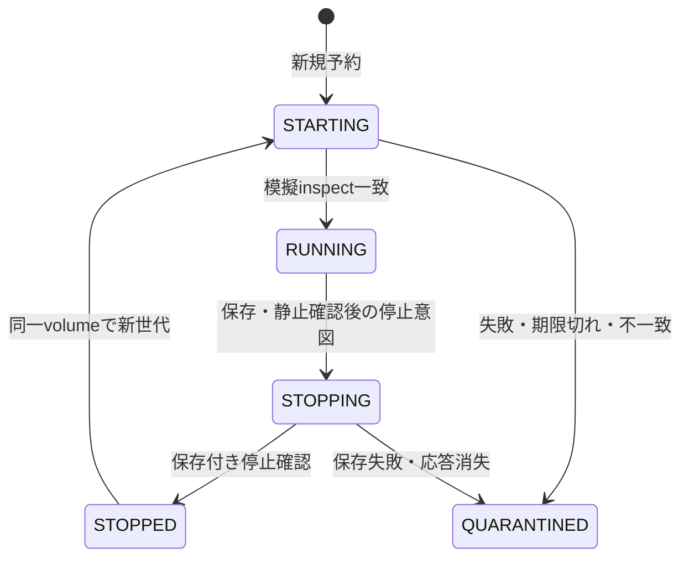

# gVisor参照アダプター：所有権・予約・障害時の動作

## 既存設計との関係

KVMのvm_id/disk_idとは異なる名前空間で、Project ID＋User IDからsandbox IDとvolume IDを生成する。Team IDも各レコードに保持して照合する。推測可能なIDは秘密情報や認証には使わない。本人と現在所属を検査する`authorizer`はモック注入で、既定値は全拒否。既存Firebase/HTTP APIにこのモジュールを接続していない。

`Profile`/`Budget`はPR #14、所有者の型は従来の`EditorBinding`を再利用する。既存VM managerの台帳やrouteは使用しない。将来KVMとgVisorを併用する場合は**共通の全体4枠の予約機関が必要**。今回の一時台帳は試験対象のgVisor内だけの4枠で、本番の二重予約機関にはしない。既存ゲートを解除しないため、現時点で実起動枠が増えることはない。

## 公開メソッドの意味

|処理|内容|
|---|---|
|`prepare`|所有権・最新証跡・設定・容量を確認し、操作意図と予約を一度に保存|
|`dispatch`|保存した完全一致のticketだけを注入モックへ渡す。既定executorは拒否|
|`finish`|本人、sandbox/volume、runtime digest、UID、設定、制限、期限、保存証跡を照合|
|`request`|prepare＋新規操作だけdispatch。同じoperation_idは記録済み履歴を返す|
|`state`|認可後の読取り。期限切れ進行中操作は隔離する|
|`uncertain`|応答消失などを隔離し、枠と保存領域を保持する|

これらはライブラリ内の契約でHTTP APIではない。任意コマンド、任意コンテナ名、接続先、hostパスを指定する引数はない。

## 状態と原子性

未作成は台帳レコードなし。STARTING/STOPPING/RUNNING/QUARANTINEDはCPU・RAM・同時枠を消費する。STOPPEDだけCPU/RAM枠を解放し、root16GiB＋data20GiBは保持する。隔離からの自動復帰・再作成・削除はない。

専用SQLiteの`BEGIN IMMEDIATE`で、全レコードの資源合計と新規操作を同時に確定する。単一プロセスのカウンターに依存しない。予算は台帳に固定され、再openでも復元する。ローカル専用ファイルシステム上の試験用であり、NFS・複数host・本番HAは対象外。レコード増加時の性能も未検証。

`Store.create_new`はO_EXCLで、既存ファイルや途中失敗ファイルを消さない。専用marker以外のDBを開いて初期化しない。通常ファイル・単一hardlink・inode同一性を検査するが、悪意あるhost管理者や親directoryの置換まで防ぐ本番resolverではない。**自分だけが操作できる一時directory以外へ使用しない。** SQLiteや操作ticketに実認証情報を入れない。

## 冪等性とfencing

operation_idはUUID、generationは各操作で増加、leaseは30秒。ticketは所有者、操作種別、設定hash、runtime digest、期限、停止時の保存nonce/revisionに束縛する。台帳とモックの最終境界の両方が照合する。別人のoperation_id再利用、古いgenerationやleaseのすり替えを拒否する。

同じIDの再送は再dispatchしない。履歴のSUCCEEDEDはその操作の過去の結果で、現在状態を保証しない。例えば停止成功後に再起動済みなら、再送結果は「世代2の停止履歴」と「現在世代3のRUNNING」を別々に返す。呼出し側は履歴だけから現在停止済みと推定してはいけない。

停止には、現在世代・5秒以内・新規job受付凍結・全client buffer flush・jobゼロを確認する集約器の一回限りnonceが必要。値不明、未保存、処理中は停止を予約しない。モック最終境界もrevision/jobs/保存を再検査する。画面が開かれていないだけで停止しない。実際の凍結、全端末保存、ファイルsync、署名検証は未実装なので、自動停止は有効化できない。

## 失敗からの扱い

|失敗箇所|今回の動作|将来の復旧条件|
|---|---|---|
|予約のDB確定前|rollbackし、executorを呼ばない|DB健全性を確認後に再要求|
|予約後・dispatch前に終了|STARTINGを保持。lease満了で隔離|operation_idと実在resource IDを照合|
|実行結果不一致・応答消失|QUARANTINED/UNKNOWN、枠を保持|実resource・所有者・世代・volumeを検査|
|作用後・完了DB書込み失敗|予約意図が残る。再読取りで期限切れ隔離|成功を推測せず、境界の永続操作履歴と照合|
|停止保存失敗|停止成功と記録せず、再作成・データ削除をしない|原本保持、保存状態を管理者確認|
|所属取消し・認可障害|再送/状態/完了も拒否|本人権限を再確認。別の内部reconcilerが必要|
|時計逆行・台帳不整合|拒否、空き枠とみなさない|管理者確認|

将来のワーカーにはcreate前の操作意図、正確なresource ID、volume ID、所有者、generation、設定hash、返答を永続保存する必要がある。本モックのexecutor履歴はメモリだけで、実ワーカー再起動耐性を実装したとは扱わない。台帳だけ再openした参照実装の復元試験と区別する。

外部作用とDBは単一transactionにならないため、未知状態を自動削除・強制停止・新規作成で解決しない。削除メソッド自体を今回追加していない。実境界での永続fencing・署名/mTLS・観測不能時の照合・管理者復旧手順が実装されるまでは接続許可を出さない。
