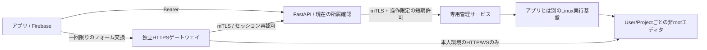

# 第7段階：個人エディタの制御と隔離の準備

## 今回の範囲と停止条件

最新mainのd0d5ae0を基点に、`feat/isolated-user-editors`で作業する。
2026年11月17日の依頼者の追加指示により、専用Linuxワーカー/VMと独立HTTPS接続先が
未準備の間は実エディタの起動・公開・接続を有効化しない。

今回実装したものは、失効確認付きFirebase認証、現在の所属・Project対応確認、
認証済みUserとProjectの紐づけ、常時無効の制御API、将来の限定ワーカー通信形式、
そのテストと新規領域だけを使う診断である。
本番個人エディタ、実ワーカー、認証プロキシ、短期接続セッションは未実装。
「第7段階の実エディタが利用可能になった」とは扱わない。

読み取り専用の既存editor_preflightの現環境判定はblocked。
Linux・seccomp・CPU/メモリ/PID上限は確認できたが、rootless・runsc・cgroup v2/systemdは未達。
これらは[以前の設計](user-editor-design.md)で選んだ基準であり、登録だけで安全性を認定しない。
別の専用VM/microVM方式も、同じ脅威モデルで実機検証すれば候補にできる。
現在のDocker Desktopへ実行基盤を自動導入したり、その設定を変更したりしない。

## 既存実装の確認

| 対象 | 現状と今回の扱い |
| --- | --- |
| Compose | backendのソースbind mount、PostgreSQLの既存保存領域、project_storageを保持。Composeは変更しない |
| code-server | 共通PASSWORD・code_server_workspaceを使うローカル検証用。個人別認証へ転用しない。Dockerfileも変更しない |
| Firebase | 既存verify_firebase_tokenは維持。新しいエディタAPIだけcheck_revoked=Trueと安全なエラー応答を使用 |
| 所属 | get_project_team_member/get_accessible_projectを再利用。UIDからUserを取り、現在のTeamMemberとProject.team_idを毎要求確認 |
| 保存 | ProjectStorageはbackend所有0700、projects/ID/workspaces/USER。非rootで直接編集できると仮定せず、権限一括変更はしない |
| Git | 同じProject下のshared.gitとreview/integration-journalはbackend専用。エディタへマウントしない |
| 提出 | ReviewGit.captureは既存個人領域を安全なFDで読み固定スナップショット化。今回もその保存先と検証は変更しない |
| 承認・統合 | 第5/6段階のDB、Git参照・操作記録・障害復旧を維持。新しいDB表・マイグレーションは追加しない |
| Vue Editor | 現在はMonaco/既存コード保存APIを使う画面。code-server画面への自動切替・起動ボタンは追加しない |

前回の隔離設計は資料名のとおり第2段階の記録として保存されている。
第5段階は承認・差し戻しの実装であり、そのコードと第6段階を今回の制御APIから呼び替えない。

## 実装したAPI（実行は常時無効）

共通パスは`/api/teams/{team_id}/projects/{project_id}/editor`。

| 操作 | 現在の動作 |
| --- | --- |
| GET 共通パス | Firebase失効確認・DB認可後、UNAVAILABLEとlaunch_enabled=falseを返す |
| POST /start | 同じ認証・認可の後に503。コンテナやworkspaceを作成しない |
| POST /stop | 同じ認証・認可の後に503。既存の共通code-serverも停止しない |
| POST /sessions | 同じ認証・認可の後に503。コード・Cookie・トークンを発行しない |
| WebSocket 共通パス以下 | 全てaccept前に1008で拒否。認証済みでも接続不可 |

GET例：

```json
{
  "project_id": 3,
  "user_id": 2,
  "state": "UNAVAILABLE",
  "launch_enabled": false,
  "message": "編集環境は準備中です。"
}
```

POST本文は省略または空オブジェクトのみ。User ID、Project ID、URL、パス、イメージ、
パスワード等を指定すれば422。検証エラーにも入力値を再表示しない。
Bearer以外のCookie・クエリを認証に使わず、Firebaseの生の失敗理由やトークンを返さない。
Firebaseを確認できない場合も401で拒否する。未認証は既存HTTPBearerにより401/403、
チーム外は403、Project/Team不一致・未知のUser/Projectは404。
セッションCookie、接続URL、コンテナ名、保存パスは返さない。

実行ゲートrequire_editor_runtimeは常に失敗する。
EDITOR_RUNTIME_ENABLED等の環境変数で実行を許可する分岐はない。
実ワーカー用のネットワーククライアントもない。起動・停止を既存Dockerへ転送しない。
このゲートは専用基盤・保存先・認証プロキシの実装をレビューする別PRでのみ置き換える。

## User/Projectの紐づけとワーカー通信境界

editor_apiは既存の所属/Project解決関数を受け取り、Firebase UIDに対応するUserと
DBのProjectからのみEditorBinding(team_id, project_id, user_id)を作る。
要求本文のUser IDやURLの変更で別人の環境を選べない。
環境キーはProject/Userから決定的に生成するUUIDであり、認可や秘密情報の代用ではない。
Teamが変わっても保存環境キーは同じだが、通信のBinding全体は一致している必要がある。

editor_contractsは以下の形式だけを定義する。

- WorkerCommand：version、operation_id、ENSURE_STARTED/GET_STATE/STOP、EditorBinding。
- WorkerState：version、operation_id、EditorBinding、STARTING/RUNNING/STOPPED/ERROR。
- 不明なフィールド・exec・データ削除・任意イメージ/マウント/URLは拒否する。
- 応答のUser/Project/Team/操作IDが一つでも異なれば拒否する。

DTOは認証付き実行許可ではない。DisabledEditorWorkerは入力に関係なく失敗する。
現在はDTOを送信せず、ワーカーのRUNNINGをアプリの実稼働として扱う経路もない。
DBに環境対応表を保存する実装、操作リース・fencing・mTLS・署名・nonce消費は将来の作業。
IDの型検証だけで、ワーカー認証や重複起動が完成したとはしない。

## 専用基盤が用意できた後のアーキテクチャ



FastAPIとゲートウェイはDockerソケットを持たない。
管理サービスは専用ワーカーの限定操作だけを受け付け、汎用Docker API、exec、任意マウントを公開しない。
Docker制御権限自体は強いので、管理サービスを分けるだけで安全になったとは判断しない。
専用ワーカーへアプリDB、Firebase鍵、他Projectの共有Gitを置かない。
コンテナには本人の保存領域だけを渡し、project_storage全体やホストパスを渡さない。

実行テンプレートはイメージdigest固定、非root、capability全削除、no-new-privileges、
read-only rootfs、個別PID/IPC/network namespace、seccomp/LSM、CPU/メモリ/PID/容量上限とする。
エディタ用ポートをホストに公開せず、ゲートウェイからの到達だけを許可する。
エディタからDB/API/管理サービス/他環境/メタデータへの新規接続を遮断し、実測する。
Docker internalネットワークを付けただけではこの通信制御は完成しない。
依存パッケージ配布やプレビューの公開は、別の許可リスト付き設計が完了するまで止める。

管理通信はmTLSの相手IDを固定し、操作・Binding・操作ID・期限・nonceを署名許可へ束縛する。
許可の一回消費、期限、再送時の同一操作、失効、リース世代を検証し、通信失敗は拒否する。
名前が一致するだけの既存コンテナを採用せず、DB対応表・管理ラベル・実マウント・設定を照合する。
同じUser/Projectへのensureは同じ環境を再利用し、停止・再作成で保存ボリュームを削除しない。
停止には現在の本人所有とコンテナID/世代を必要とし、データ削除操作を通信形式に追加しない。

## 接続セッションと失効の将来仕様

アプリとエディタは異なるサイトとし、User/Project別のエディタホストを使う。
Firebaseトークンをエディタ・URL・ログ・WebSocketサブプロトコルへ渡さない。
アプリから短期30秒・一回限り・PKCE相当verifier付きコードを取得し、トップレベルの
フォームPOSTでゲートウェイへ交換する。正確なOrigin・ホスト・所有関係を確認する。
Cookieは__Host-接頭辞、Secure、HttpOnly、SameSite=Lax、Path=/、Domainなし、最大5分。
ホスト・Binding・期限へ束縛し、Cookie/Authorizationをcode-serverへ転送しない。
上流Set-Cookieがゲートウェイの認証Cookieを上書きすることも拒否する。

HTTP各要求、WebSocket Upgrade前、接続中15秒以内の再確認で現在所属・失効・期限を確認する。
再認可先の障害でも新規接続は拒否し、既存接続も期限で閉じる。
チーム脱退時には接続と許可を失効させ、ワーカーの停止・隔離も行う。
停止失敗時もゲートウェイは閉じ、実行プロセスを利用可能なまま公開しない。
ログアウト・期限・アカウント失効も同じ経路で扱う。
現在はセッションを一切作らないため、これらの継続セッション失効は未実装・未検証である。

## 保存先と既存提出フローを壊さない移行手順

専用ワーカーへ同名ボリュームを作っても既存保存先と同じデータにはならない。
既存の0700領域を一括chown/chmodすることや、旧領域全体のマウントで回避しない。
以下は移行プログラム実装前の手順案で、今回実行していない。

1. 停止対象と保存先を棚卸しし、DB・Git・レビュー/統合ジャーナル・workspaceの整合したバックアップを取る。
2. 保存先対応表を新規の明示マイグレーションで追加し、旧形式を既定にして既存APIを維持する。
3. 対象Project/Userの編集・提出・初期化を凍結し、操作IDとリースで二重移行を防ぐ。
4. 元領域をFD経由で読み、symlink/hardlink/特殊ファイル・危険なパスを拒否する。
5. 本人専用の新しい保存先へO_EXCL・上限・内容ハッシュ付きで一回だけ移送する。
   権限を設定するのは新規コピーだけ。元領域・code_server_workspaceは変更しない。
6. 新保存先を検証後、編集・初期化・提出の全アクセスを一つの対応表へ原子的に切り替える。
   元とコピーの両方を編集できる状態を作らない。旧workspace初期化で別コピーを再作成しない。
7. 提出はエディタの.gitを実行せず、凍結した通常ファイルだけを検証済み移送口へ取り込み、
   既存ReviewGitの固定スナップショット作成・共有Git側の参照管理へ渡す。
8. 承認・統合とその復旧は共有Git側だけで継続し、エディタは共有bareに直接到達させない。
9. 失敗時は新保存先を未使用/隔離で保持する。古いコピーで新しい編集を上書きしない。
   復旧も書込み凍結・保全・照合の後に行い、元データやボリュームを自動削除しない。

この保存先解決・移送・fencingが未実装の間は、既存領域を実エディタへ公開しない。
005等の移行SQLや新しいComposeは今回追加していない。

## 診断用コンテナ試験

editor-lab.Dockerfileはcode-serverを含まない。既知の診断スクリプトとGitだけを使い、
イメージ内の新規/workspaceをUID/GID 1000にする。既存ボリュームの権限を変更しない。
実行は非root、read-only、network=none、IPCなし、cap全削除、no-new-privileges、
128MiB・0.5CPU・PID32・16MiB tmpfs。ポート、ソケット、ホストbind mount、資格情報を渡さない。

試験は毎回UUID名と所有ラベルで、新規ボリューム4個を作る。
A/B/別Project/共有bare相当を分け、各コンテナに一つだけマウントする。
Aが編集できること、B/別Project/共有Gitが見えないこと、AのGit直接更新が失敗すること、
ターミナル相当の子プロセスでsetuid(0)・rootfs書込みができないことを確認する。
同じ停止済みAコンテナを再起動し、さらに新コンテナでも同じ新規ボリュームの編集を確認する。
Aの操作後にB/別Projectの内容と共有bareのmainが不変なことも確認する。

後片付けは作成を確認したリソースだけを逆順に行い、名前・所有ラベルが違えば止める。
既存名を入力できるインターフェース、prune、汎用コンテナ停止機能はない。
作成応答不明や診断失敗で残存物が疑われる場合は、記録・ラベルを保全して個別確認し、
環境全体を掃除するコマンドは使わない。

ホストのbackendディレクトリから再実行する例（既存環境へ適用する操作ではない）：

```powershell
docker build -f tools/editor-lab.Dockerfile -t progress-editor-isolation-lab .
$env:EDITOR_LAB_IMAGE_ID = docker image inspect progress-editor-isolation-lab --format '{{.Id}}'
python -m unittest discover -s tests -p test_editor_container_lab.py -v
Remove-Item Env:EDITOR_LAB_IMAGE_ID
```

実行には診断イメージの不変なimage IDとラベルの確認が必要。通常の全件回帰では明示的にスキップする。
Dockerソケットを回帰テスト用コンテナへマウントして動かす方法は採用しない。

### 実行結果（2026年11月17日）

既存201件＋制御/通信形式14件＋明示実行の診断1件で合計216件。

| 環境 | 成功 | スキップ |
| --- | ---: | ---: |
| Linux / 一時PostgreSQL 15 | 214 | 2 |
| Linux / SQLite | 187 | 29 |
| Windows（既存の仮想環境） | 54 | 162 |
| ホストから明示した診断コンテナ試験 | 1 | 0 |

PGの2件はDocker CLI不在のCompose検証と、明示指定が必要な診断コンテナ試験。
SQLiteはPostgreSQL専用27件もスキップ。WindowsはLinux/PG専用をスキップする。
ComposeはWindowsで、診断1件は専用イメージ・新規ボリュームで別途成功した。
診断は9回の起動（同じコンテナの再起動を含む）を行い、4ボリューム・8コンテナを
所有ラベルと照合して片付けた。これは実code-serverの起動数ではない。
Dockerビルド、git diff --checkも成功。既存TestClientの非推奨警告は残る。

実Firebase通信、実ワーカー、署名許可/mTLS、TLS/Cookie交換、接続中WS失効、
悪意ある任意コード、実code-server、既存保存先の移行は未検証・未実装として区別する。
実行基盤の事前判定はblockedのままであり、診断成功で実行を有効化していない。

## 要件ごとの検証範囲

| 要件 | 今回確認した範囲 | 残るもの |
| --- | --- | --- |
| 自分の編集 | A専用の新規診断ボリュームを編集 | 実code-serverと既存workspaceの移行 |
| 他ユーザー拒否 | 新規B領域の未マウントと内容保持、HTTPの本人解決 | 任意悪意コード・実ワーカーでの隔離 |
| 共有main保護 | 新規診断bareの未マウント・更新失敗・main不変 | 実基盤のネットワーク横断・脱出評価 |
| 別Project | 新規領域の未マウント、HTTPのProject/Team確認 | 保存先切替後の全経路実測 |
| 未認証 | HTTP拒否、WebSocket全拒否 | 実TLSゲートウェイ |
| URL/ID変更 | 本文ID拒否・クエリIDを信用しない・別Team/Project拒否 | ゲートウェイのCookie/Host/Origin束縛 |
| チーム脱退 | 次のHTTPで拒否 | 接続中WebSocketの失効・ワーカー停止 |
| ターミナル | 診断子プロセスのUID/cap/rootfs/マウント制約 | コンテナ脱出耐性・DoS評価 |
| 再起動保持 | 新規Aボリュームで停止/再起動/再作成の保持 | 実エディタの障害復旧・容量制御 |
| 既存フロー | 既存提出・承認・統合の回帰 | 移行後保存先との実接続 |

## 専用基盤が整った後の導入順序

1. アプリとは独立したステージングLinux基盤と、エディタ専用TLS/DNSを準備する。
2. 脅威モデル、runtime、UIDマップ、ネットワーク制限、容量/リソース上限を実測する。
3. 環境対応表・移送・提出の保存先解決を実装し、コピーだけでなく切替・復旧も試験する。
4. 管理サービスのmTLS/署名許可/冪等操作を実装し、他環境の操作・既存名衝突を拒否する。
5. セッション交換・Cookie・Origin・HTTP/WS・期限/脱退/失効の切断を実装し、直接経路を遮断する。
6. 実code-serverのA/B隔離、ターミナル・ポート転送・プレビュー・拡張機能・再作成を試験する。
7. 本番と整合したバックアップ・限定移行・ロールバック計画をレビューしてから、別PRで実行ゲートを変更する。

現在の共通code-serverやcode_server_workspaceを削除・移動・自動移行する手順は含めない。
今回のPRをレビューするだけで稼働環境へ配備しない。mainへのマージも自動では行わない。

## 参照資料

- [既存の隔離設計・事前検証](user-editor-design.md)
- [Docker volumes](https://docs.docker.com/engine/storage/volumes/)：保存領域とコンテナのライフサイクル、初回コピーの扱い。
- [Docker rootless](https://docs.docker.com/engine/security/rootless/)：デーモンを含む非root化とユーザー名前空間。
- [code-serverの公開](https://coder.com/docs/code-server/guide)：認証と暗号化を備えた公開経路の必要性。

2026年11月17日に一次資料を確認。文書・診断の成功だけで本番隔離を保証しない。
