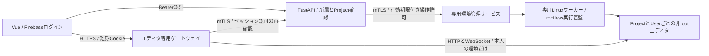

# 第2段階：個人別code-serverの設計・事前検証

## 今回の到達点

最新mainの`d604481`から`feat/user-editor-isolation`を作成しました。
専用Linuxサーバー／VM／HTTPSドメインがまだないため、依頼者の追加指示に従い、
Windows＋Docker Desktopで安全に実施できる設計・テスト・事前検証を今回の範囲とします。

**個人別code-serverの起動API、認証ゲートウェイ、短期セッション、Vueの起動ボタンは未実装です。**
この資料のAPI・データ構造・接続手順は今後の実装案であり、現在利用できる機能ではありません。
本番の安全性が確認できたと誤認させる起動フラグや暫定の公開経路も追加しません。

追加物は、読み取り専用のDocker事前検証ツール、診断専用コンテナ用の確認ツール、
そのテスト、既存作業領域の権限を確認するテスト、本資料です。
アプリのDB・API・Vue・Compose・既存code-server・ProjectStorageの実装は変更しません。
既存データ・権限・Dockerボリュームを変更／削除せず、秘密情報も参照・コミットしません。

## 現状の調査結果と判断

| 確認対象 | 現状と影響 |
| --- | --- |
| 認証 | FastAPIのFirebase Bearer認証とget_project_team_member／get_accessible_projectが存在。ブラウザのcode-serverナビゲーションやWebSocketへそのまま適用される構成はない |
| 保存 | ProjectStorageが共有bareリポジトリとprojects/ID/workspaces/USERを分離。ディレクトリはバックエンド所有、0700。非rootエディタが書けると仮定できない |
| Docker | 調査時のcontextはdesktop-linux、APIは1.55。SecurityOptionsはseccompとcgroupns。rootlessの報告なし。runscの登録なし |
| 接続 | 現在のComposeはローカルHTTP中心。エディタ専用HTTPSドメイン、ゲートウェイ、セッション失効処理は未整備 |
| 既存code-server | 127.0.0.1:8080のローカル検証用。共通パスワード・共通作業領域を個人別認証の代替にしない |

通常のDockerが常に危険だと判定しているわけではありません。今回の脅威モデルには、
利用者が任意プログラムや悪意あるコードを実行する場合も含めています。
現在の設定だけでその隔離を確認できないため、公開運用へ進めないという判断です。

以下は今回選んだ**検討用の基準構成**です。rootlessやrunscは依頼の文言そのものではなく、
追加の安全策として提案するものです。登録されているだけで安全とは判断しません。
専用VM／microVM等の別案も、同じ脅威モデルに対する評価を行えば選択可能です。

## 将来の構成



- FastAPIは利用者の認証・権限判断だけを担当し、Dockerソケットを持ちません。
- 環境管理サービスだけが、アプリ本体と分離した専用ワーカーの実行基盤を操作します。
  操作はensure_started／get_state／stopに限定し、汎用Docker APIの転送、exec、任意イメージや任意マウントを受け付けません。
- ゲートウェイはエディタ専用の別オリジンで動かします。アプリ本体のFirebase秘密鍵、DB資格情報、Dockerソケットを渡しません。
  認可の確認先はmTLSで認証したFastAPIの限定された内部APIです。
- ユーザーコンテナには、そのProject・Userに対応する保存領域だけを渡します。
  共有bare、他人の領域、project_storage全体、ホストディレクトリ、管理用ソケットは渡しません。
- ユーザーの編集・拡張機能・プレビューから配信される内容も信頼しません。
  アプリのログイン情報と同一オリジンにエディタを置く設計は避けます。

環境管理サービスの侵害は、そのワーカー上の環境へ影響し得ます。
サービスを分けるだけでDocker管理権限が小さくなるわけではありません。
ワーカーへアプリの秘密を置かず、管理通信・認可・監査・パッチ運用を独立させます。
より強い利用者間の境界が必要な場合は、ユーザー別VM／microVMを選びます。

管理要求はmTLSに加えて、操作・User・Project・期限・一回限りのnonceに束縛した
バックエンド発行の短期許可で検証します。ブラウザから管理サービスへ直接要求させません。
任意のコンテナ名、ホストパス、起動引数、環境変数、ボリューム名を要求に含めても採用せず、
サーバー側の対応表と固定テンプレートから決めます。

### 実行時の制約案

固定したダイジェストのcode-serverイメージ、非rootのUID/GID、読み取り専用rootfs、
capabilities全削除、no-new-privileges、seccomp、ホストのLSM制御、CPU・メモリ・PID・保存容量上限を使います。
書き込み先は個人領域と容量制限付き一時領域だけにします。起動時にrootになるスクリプトは使いません。

rootless＋runscを基準案とし、cgroup v2／systemdでリソース制限が実際に効くことを検証します。
gVisorでのcode-server・ターミナル・コンパイラの互換性も実機検証が必要です。
rootless化やgVisor導入を、既存Docker Desktopや既存ボリュームへ自動適用しません。

利用者ごとに独立したネットワークとプロセス空間を設け、エディタのポートはホストへ公開しません。
ゲートウェイから対象エディタへの通信とその応答だけを許可し、エディタからの新規外向き通信は原則拒否します。
DB・API・メタデータサービス・管理サービス・他利用者への到達を遮断します。
Dockerのinternalネットワーク指定だけでこの制御が完成したとは扱いません。
通信制御の実測後に利用可能にします。依存パッケージ配布は、将来、許可リスト付きの専用プロキシを検討します。

## 既存領域を保持する移行案

既存の0700領域に対する再帰chown／chmod、共有ボリューム全体のマウント、
非root制約を外す回避策は採用しません。今回、権限変更は一切行っていません。

専用ワーカーは別Dockerデーモンになるため、同じ名前を付けても既存の名前付きボリュームには接続できません。
既存個人領域を保全したうえで、個人別の新規保存ボリュームへ移行する案を基本とします。

1. 対象Project・Userを認可し、その組み合わせだけをロックして書き込みを一時停止する。
2. ProjectStorageのパス検査を再利用し、symlink・ハードリンク・特殊ファイルを拒否する。
3. そのユーザーの領域だけを、新規の隔離された保存先へ排他的にコピーする。元データは変更しない。
   書き込み可能な任意のtarを信用しない。相対パス検証・O_NOFOLLOW・O_EXCL・サイズ上限付きの移送処理が必要。
4. 新規コピーだけにエディタUID/GIDを設定し、内容ハッシュと必要なGitデータを照合する。
5. Project・User・ワーカー・保存先・形式バージョン・移行状態をサーバー側に記録し、検証成功後に利用先を切り替える。
   個人領域への全アクセス経路をこの対応表へ統一し、元と移行先の両方で編集できる状態を作らない。
6. 途中失敗は新規保存先を未使用のまま残し、既存元領域を維持する。無条件で再コピー／上書きしない。

停止・再作成では同じ個人ボリュームを再利用し、自動削除しません。
移行後にProjectStorageの旧workspace初期化APIが別コピーを作らないよう、保存先解決の拡張が必要です。
元領域の削除や復旧での上書きは、別途方針確認の対象です。今回は移行コードを実行しません。

同じデーモン内で部分マウントする代替案にはDockerのvolume-subpathがありますが、
所有権や任意コード隔離を解決する機能ではありません。基盤と権限の検証を省略する理由にはしません。

## Firebaseからエディタへの認証経路案

接続例はアプリを`app.example.com`、エディタを`<opaque-id>.editors.example.net`とします。
エディタはProject・Userごとに別ホストとし、TLS・DNS・リバースプロキシの管理を前提とします。
不透明なホスト名は認証情報ではなく、そのURLを知っていても認証がなければ接続できません。

1. VueはFirebase IDトークンをAuthorizationヘッダーに付けてFastAPIへ起動要求する。
   get_project_team_memberとget_accessible_projectを再利用し、Userは認証済みUserから取得する。
2. 起動完了後、Vueは再度Bearer認証して短期セッションの引き継ぎを要求する。
   セッション発行・更新ではFirebaseの失効確認も行う。現行verify_id_tokenはcheck_revokedを指定していないため、
   既存の認証依存だけでアカウント失効対応が済んだとは扱わない。
   Vueは暗号学的乱数からverifierを生成してメモリ内に保持し、発行要求にはそのハッシュを渡す。
3. 有効期限30秒・一回限りのランダムな引き継ぎコードを発行する。
   サーバー側にはハッシュ、User、Team、Project、対象ホスト、verifierのハッシュ、期限を保持する。
4. ユーザー操作で開くトップレベルのフォームPOSTで、コードとverifierをゲートウェイの専用交換口へ渡す。
   トークンをURL・クエリ・Referer・WebSocketのサブプロトコルへ入れない。
   Firebaseトークン自体はエディタやゲートウェイへ渡さない。
5. ゲートウェイは正確なOriginの許可リストと宛先ホストを確認し、FastAPI経由でコードを原子的に一回だけ消費する。
   交換成功前にcode-serverへ転送しない。
6. ゲートウェイは256bit以上のランダムな短期セッションCookieを発行する。
   __Host-接頭辞、Secure、HttpOnly、SameSite=Lax、Path=/、Domain未指定を使用する。
   User・Project・Team・ホストに紐付け、有効期限は最大5分かFirebaseトークン残存時間の短い方とする。
7. HTTP要求ごととWebSocketのUpgrade前に、期限・失効・所有者・ホスト・現在のチーム所属を確認する。
   CookieやAuthorizationはcode-serverへ転送しない。エディタが返すCookieでゲートウェイの認証Cookieを上書きさせない。

この構成でcode-server自身のパスワード認証を外す場合は、ゲートウェイ以外から接続できないことを
実機で確認した環境だけに限定します。共通code-serverの認証設定は変更しません。

コード・verifier・セッション値をログへ記録せず、交換レスポンスはno-store／no-referrerにします。
コードの再利用、別環境への転用、任意のリダイレクト先、信頼していないForwarded／Hostを拒否します。
エディタ内のHTML・プレビュー・Service Workerがアプリの認証領域に届かないよう、
アプリとエディタ間のCORS・Cookieの共有を許可しません。
ポート転送やwebviewの公開も、認証を迂回する経路を作らない別設計が完了するまで無効とします。

### WebSocketと失効

Upgrade時にCookieだけでなく、その環境の正確なHTTPS Originを照合します。
未認証・期限切れ・別環境のCookie・Origin不一致は接続前に拒否します。
接続中も期限タイマーで切断し、所属・失効を15秒以内で再確認する設計とします。
ログアウト時はセッションを失効させ、関連接続を閉じます。
分散ゲートウェイでは失効イベントの配信とセッションストアを共有し、
認可確認先に到達できない場合は新規接続を拒否し、既存接続も再確認期限で閉じます。
接続数・フレームサイズ・帯域・アイドル時間に上限を設けます。
これは設計要件であり、現時点でWebSocket認証が実装・検証されたという意味ではありません。

## 起動・状態管理・Vueの実装案

API案の共通パスは`/api/teams/{team_id}/projects/{project_id}/editor`です。

| 操作案 | 処理 |
| --- | --- |
| POST `/start` | 本人の環境を冪等に起動。未移行・基盤不適合なら安全側に拒否 |
| GET `/` | starting／running／stopped／errorを返す。runningはヘルスチェック成功後のみ |
| POST `/sessions` | Firebase再認証・現在の所属確認後、一回限りの引き継ぎコードを発行 |
| POST `/stop` | 本人の環境だけを停止。保存ボリュームは残す |

これらのAPIは今回追加していません。
環境の対応表は(Project, User)を一意にし、DB制約とリース／fencingで重複起動を防ぎます。
環境管理サービスは決定的な内部名を使い、名前の衝突時は管理ラベルと実際の設定を照合します。
不明なコンテナを引き継いだり削除したりしません。管理者が与えた固定テンプレートのみで作成します。

DB記録と実行基盤の操作は単一トランザクションにならないため、操作IDで状態を再照合します。
作成成功後に応答が失われても再起動・再作成せず、同じ環境を検出して状態を返します。
ヘルスチェック失敗はerrorとして扱い、ボリュームを消してやり直しません。
quota不足・認可失効・停止処理・ワーカー停止からの再開も同じ対応表で扱います。

Vueは既存のホーム・Editor画面を保ちつつ、チームとプロジェクトを選ぶ画面を追加する案です。
所属チームとプロジェクトを既存APIで取得し、「コードを編集」で本人環境を起動します。
有限時間のポーリングで状態を表示し、ready後に別のユーザー操作で安全な引き継ぎを行います。
任意のURLをAPIから受けて開かず、許可されたエディタドメインだけを使います。
画面離脱時にポーリングを止め、期限切れは再ログイン、起動失敗は再試行できる表示にします。
基盤未準備の状態を「起動済み」と表示しません。

## 今回追加したツールとテスト

### 実行基盤の事前確認

backendで`python tools/editor_preflight.py`を実行します。
実行するDockerコマンドは引数配列の`docker info --format {{json .}}`だけです。
コンテナ起動・停止、ソケット公開、権限変更、設定ファイルや.envの読み取りは行いません。
ホストパスや生のDocker出力・エラーは出さず、必要な判定だけをJSONにします。

現環境の結果はblockedで、rootless、runsc登録、cgroup v2／systemdの基準が未達でした。
他の条件が通っても、安全性認証やエディタ起動許可には使いません。
全項目が通った場合もrequires_validationとし、editor_launch_enabledは常にfalseです。
終了コードはblocked／unavailableが2、事前条件が通る場合は0です。

### 診断専用コンテナ

以下はアプリのユーザー環境ではなく、既知の診断プログラムだけを実行する試験です。
公開ポート、Dockerソケット、データボリューム、ホストマウント、秘密情報を渡しません。

```text
docker build -t progress-editor-preflight-test backend
docker run --rm --user 1000:1000 --network none --read-only --cap-drop ALL --security-opt no-new-privileges --memory 128m --cpus 0.5 --pids-limit 32 --tmpfs /tmp:rw,nosuid,nodev,noexec,size=16m,uid=1000,gid=1000,mode=0700 progress-editor-preflight-test python -B tools/editor_sandbox_probe.py
```

診断ではUID/GID、実capability、NoNewPrivs、seccomp、ネットワークインターフェイス、
rootfsの読取専用属性、実cgroup上限、既知の秘密鍵・ソケットの不在を確認します。
未知のソケットや秘密ファイルの完全検出、コンテナ脱出耐性、攻撃者間の隔離を証明するものではありません。

既存領域の権限確認テストは新しい一時ディレクトリだけを使います。
再初期化で所有者・権限・内容が維持されることと、root所有0700領域へUID 1000の子プロセスが書けないことを検証します。
このテストのUID変更は使い捨てコンテナ内の子プロセスだけです。

## 検証の区別

| 項目 | 今回の扱い |
| --- | --- |
| 既存の認証・チーム所属・Project対応確認、個人作業領域の分離、Git初期化 | 既存の自動テストを再実行 |
| 事前条件不足・不正な応答・機密情報の非出力・読み取り操作限定 | 新規単体テストで確認 |
| 既存権限とデータの維持、既定の非root書き込み拒否 | Linux上の新規テストで確認 |
| 非root・capabilityなし・通信なし・read-only・リソース制限 | Docker Desktopの診断コンテナで実測 |
| 個人別エディタA/Bのプロセス・コンテナ分離、他人のURL拒否 | 未実装。専用基盤とゲートウェイ完成後に実機試験 |
| 実Firebase＋短期Cookie、コード一回消費、HTTPS／WSS、WebSocket失効 | 未実装・未検証。TLS試験環境で統合試験が必要 |
| エディタの重複起動防止、個人エディタ再作成後の保持 | 未実装・未検証。第1段階の保存領域テストとは区別する |
| 権限付きコピー移行、rootless／runscでのcode-server起動 | 未実装・未検証。新規保存先と専用ワーカーが必要 |
| ネットワーク横断・脱出耐性・DoS・障害復旧 | 専用の非本番基盤で試験。実利用者へ公開する前に完了する |

HTTPS／WSSの試験自体は、本番へ公開しなくても隔離されたTLS試験環境で行えます。
今のWindows環境で未確認なことを「本番でしか試せない」とは扱いません。
実運用の証明書・DNS・ネットワーク制御・失効イベント配送は、本番相当のステージングと本番で別途確認します。

### 今回の実行結果（2026年11月16日）

- 新規テストは14件（事前検証12件、保存領域の権限確認2件）。既存53件と合わせて67件。
- Linux＋PostgreSQL 15：66件成功、Compose検証1件はコンテナ内にDocker CLIがないためスキップ。
  PostgreSQLはメモリ上の一時データ領域を使い、既存DB・ボリュームには接続していません。
- Linux＋SQLite：64件成功、Compose検証1件とPostgreSQL専用2件をスキップ。
- Windows：38件成功、Linux専用27件とPostgreSQL専用2件をスキップ。Compose検証は成功。
- 診断専用コンテナの11項目はすべて成功。補助グループを含めて非rootであることも確認。
- 実行基盤の事前判定は想定どおりblocked。実運用へ移行可能とする判定はしていません。
- Dockerイメージのビルド、git diff --checkは成功。
- 既存TestClient依存の非推奨警告がありますが、テストは成功しました。

再実行はbackendで`python -m unittest discover -s tests -v`を使用します。
Dockerでは上記でビルドしたイメージに対して
`docker run --rm progress-editor-preflight-test python -m unittest discover -s tests -v`で実行できます。
PostgreSQL専用テストは、隔離した試験DBのURLをPROJECT_TEST_DATABASE_URLに設定してください。
テスト自身がランダムな専用スキーマを作成し、その試験データだけを後片付けします。

## 次の実装を開始する条件

1. アプリの秘密を持たない専用LinuxワーカーかVMと、選択した隔離方式を用意する。
2. エディタ専用ドメイン・TLS・ゲートウェイの到達経路を試験環境で用意する。
3. 個人別の保存先とUID/GID対応、既存データ保持・一方向切替の移行方式をレビューする。
4. 環境管理サービスの許可操作とmTLS、セッション保存・失効・監査の実装を分けてレビューする。
5. 上表の未検証項目を含む統合試験に成功してから、Vueの編集環境起動を有効にする。

変更レビュー・承認・共有bareへの統合・最新版取得は、引き続き次の段階です。

## 参照した一次資料

- [Docker Engine security](https://docs.docker.com/engine/security/): Docker管理APIの権限とホストへの影響。
- [Docker Rootless mode](https://docs.docker.com/engine/security/rootless/): デーモン・コンテナの非root化。
- [Rootless Tips](https://docs.docker.com/engine/security/rootless/tips/#limiting-resources): cgroup制限の適用条件。
- [Docker volume subdirectory](https://docs.docker.com/engine/storage/volumes/#mount-a-volume-subdirectory): 部分マウントの要件。
- [gVisorの概要](https://gvisor.dev/docs/)・[Rootless](https://gvisor.dev/docs/user_guide/rootless/): 追加隔離の候補と運用条件。
- [code-serverの安全な公開](https://coder.com/docs/code-server/guide): 認証・暗号化・WebSocket対応。
- [OWASP WebSocket Security](https://cheatsheetseries.owasp.org/cheatsheets/WebSocket_Security_Cheat_Sheet.html): Origin・セッション期限・失効の確認。
- [OWASP Session Management](https://cheatsheetseries.owasp.org/cheatsheets/Session_Management_Cheat_Sheet.html): Cookieの保護とセッション管理。

これらの資料は判断材料です。本資料のサービス分離・移行手順・TTL等は、本プロジェクト向けの設計案です。
